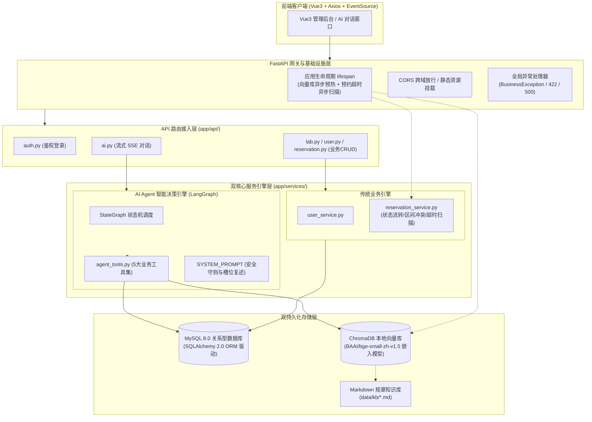

# 🏫 智能实验室预约与 AI Agent 系统 (Smart Lab Agent)

<p align="center">
  
  
  
  
  
  
  
</p>

> 基于 **FastAPI + SQLAlchemy 2.0 + MySQL + ChromaDB + LangGraph + Vue3** 构建的现代化全栈“业务 CRUD + AI Agent 智能调度”双引擎系统。

---

## 🌟 核心亮点与架构特色

### 1. 🤖 工业级 AI Agent 状态机调度（LangGraph）
* **有向状态机闭环**：基于 LangGraph 的 `StateGraph` 与 `MessagesState`，将大模型决策与工具调用拆解为受控图节点流转，杜绝暴力 Prompt 裸调。
* **人在回路（Human-in-the-loop）**：针对高危写库操作（实验室预约落库），强制要求槽位信息复述并由用户显式回复“确认”后才触发写入，避免大模型幻觉篡改核心业务资产。
* **死循环熔断保护**：通过 `recursion_limit: 10` 配置硬性递归步数保险丝，防止智能体在 `agent` 与 `tools` 之间反复死循环。
* **SSE 打字机实时推送**：基于 Server-Sent Events（`text/event-stream`）实现单向流式推流，前端秒级渲染大模型思考过程与打字机文本。

### 2. 📚 端侧轻量化 RAG 规章知识库（ChromaDB）
* **语义向量检索**：集成本地 ChromaDB 向量数据库与 `BAAI/bge-small-zh-v1.5` 中文语义嵌入模型，将规章制度映射为 512 维向量空间。
* **冷启动模型预热（Warmup）**：利用 FastAPI `lifespan` 机制与 `asyncio.to_thread`，在服务启动时于独立后台子线程异步预热模型权重，彻底消灭首个用户的“冷启动卡死（10s毛刺）”。
* **语义置信度过滤**：基于空间欧式距离计算归一化置信度分数（`score = 1 / (1 + dist)`），自动剔除 `< 0.5` 的低相关性文档杂质。

### 3. ⚡ 现代高并发后端工程体系
* **数学区间互斥冲突算法**：基于 De Morgan 定律建立时间重叠充分必要条件判定公式（`start < other_end and end > other_start`），一条 SQL 查询完成毫秒级冲突排查，完美支持首尾顺延无缝衔接。
* **常驻后台扫描协程**：在 `lifespan` 中挂载轻量级后台轮询任务，利用非阻塞的 `await asyncio.sleep(60)` 自动扫描并作废过期待审核预约，优雅关机（Graceful Shutdown）时自动调用 `task.cancel()`。
* **声明式 RBAC 安全门禁**：基于 `OAuth2PasswordBearer` + JWT 防伪数字签名，结合 FastAPI `Depends` 依赖注入实现软硬门禁分流（`get_current_user` 强制 401 拦截 vs `get_optional_user` 游客静默降级）。
* **标准契约与全局穿透异常**：全量推行 Pydantic 强类型响应封装（`Response` / `PageResponse`）与基于 `BusinessException` 的业务熔断弹射，前后端网络状态码与业务码彻底解耦。

---

## 🏛️ 系统架构全景图



---

## 📁 目录结构

```text
lab--agent/
├── backend/                  # 后端源码 (FastAPI)
│   ├── app/
│   │   ├── api/              # 路由层 (auth, user, lab, reservation, ai)
│   │   ├── common/           # 通用契约 (Response, BusinessException)
│   │   ├── dependencies/     # 依赖注入 (get_current_user, get_optional_user)
│   │   ├── models/           # SQLAlchemy 2.0 ORM 数据模型
│   │   ├── schemas/          # Pydantic 入参出参校验模型
│   │   ├── services/         # 业务逻辑与 Agent 状态机 (agent_service, kb_service)
│   │   ├── utils/            # 工具库 (jwt, password)
│   │   ├── config.py         # 环境变量与动态绝对路径配置
│   │   ├── database.py       # 数据库连接池与 get_db 会话管理
│   │   └── main.py           # FastAPI 入口与 lifespan 生命周期调度
│   ├── data/
│   │   ├── chroma/           # ChromaDB 向量数据持久化目录
│   │   └── kb/               # Markdown 规章制度原文档
│   ├── sql/
│   │   └── init.sql          # 数据库初始化建表脚本
│   ├── .env.example          # 环境变量脱敏参考模板
│   └── requirements.txt      # 后端依赖清单
├── frontend/                 # 前端源码 (Vue 3 + Element Plus + Vite)
│   ├── src/
│   │   ├── api/              # Axios 请求模块与 EventSource SSE 读流
│   │   ├── views/            # 业务页面 (预约大厅, 设备管理, AI 对话)
│   │   └── router/           # 路由守卫与鉴权
│   ├── package.json
│   └── vite.config.js
└── README.md
```

---

## 🚀 极速上手与本地部署

### 1. 后端启动 (FastAPI)

```bash
cd backend

# 1. 创建并激活虚拟环境 (可选)
python -m venv .venv
# Windows:
.venv\Scripts\activate

# 2. 安装依赖
pip install -r requirements.txt

# 3. 配置环境变量
cp .env.example .env
# 在 .env 中填入你的 MySQL 数据库连接串与 LLM API Key (如 DeepSeek / OpenAI)

# 4. 初始化数据库 (可选，系统亦支持自动建表)
mysql -u root -p < sql/init.sql

# 5. 启动开发服务器
uvicorn app.main:app --reload --port 8000
```
启动后访问接口交互式文档：[http://127.0.0.1:8000/docs](http://127.0.0.1:8000/docs)

### 2. 前端启动 (Vue 3)

```bash
cd frontend

# 安装依赖
npm install

# 启动前端开发服务器
npm run dev
```
启动后访问系统主页：[http://localhost:5173](http://localhost:5173)

---

## 📄 开源许可证

本项目基于 [MIT License](LICENSE) 开源许可。
