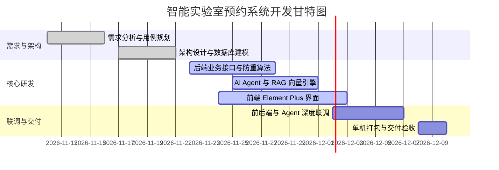

# 智能实验室预约与 AI Agent 系统项目计划书

| 项目编号 | 202604008 |
| :--- | :--- |
| **文档编号** | **1.0** |
| **密级** | **内部** |

<br/>

<div align="center">
  <h1>智能实验室预约与 AI Agent 系统项目计划书</h1>
  <h3>V1.0</h3>
  <br/><br/><br/><br/><br/>
  <p><strong>评审日期：2026年11月15日</strong></p>
</div>

<div style="page-break-after: always;"></div>

---

## 目录

- [1 引言](#1-引言)
  - [1.1 编写的目的](#11-编写的目的)
  - [1.2 背景](#12-背景)
- [2 项目概述](#2-项目概述)
  - [2.1 工作内容](#21-工作内容)
  - [2.2 主要参加人员](#22-主要参加人员)
  - [2.3 项目产品](#23-项目产品)
    - [2.3.1 程序](#231-程序)
    - [2.3.2 文件](#232-文件)
  - [2.4 完成项目的最迟期限](#24-完成项目的最迟期限)
  - [2.5 本计划的批准者和批准日期](#25-本计划的批准者和批准日期)
- [3 实施计划](#3-实施计划)
  - [3.1 工作任务的分解与人员分工](#31-工作任务的分解与人员分工)
    - [3.1.1 工作分解结构 (WBS)](#311-工作分解结构-wbs)
    - [3.1.2 人员分工](#312-人员分工)
  - [3.2 接口人员](#32-接口人员)
  - [3.3 时间进度计划](#33-时间进度计划)
  - [3.4 预算](#34-预算)
  - [3.5 关键问题与风险应对](#35-关键问题与风险应对)
- [4 支持条件](#4-支持条件)
  - [4.1 计算机系统支持](#41-计算机系统支持)
- [5 专题计划要点](#5-专题计划要点)

<div style="page-break-after: always;"></div>

---

## 1 引言

### 1.1 编写的目的

本计划书旨在指导“智能实验室预约与 AI Agent 系统”的全周期开发与交付过程，帮助项目团队明确技术架构、细化阶段目标、规范任务分工，确保系统在排期内高质量、低风险完成研发、调试与上线部署。

**预期读者**：项目指导老师/评审专家、项目经理、前后端开发人员、算法工程师、测试人员及系统维护人员。

### 1.2 背景

- **系统名称**：智能实验室预约与 AI Agent 系统（Intelligent Lab Booking & Agent System）
- **技术架构**：前后端分离架构 + 认知智能大模型工作流（Agentic Workflow）+ 本地向量数据库检索增强（RAG）
- **前端技术**：Vue 3 + Vite + Element Plus + Pinia + Vue Router + Axios + SSE (Server-Sent Events 流式打字机通信)
- **后端技术**：Python 3.13 + FastAPI + SQLAlchemy 2.0 (全类型安全 Mapped 映射) + Pydantic v2 + Uvicorn + JWT (无状态RBAC鉴权) + Bcrypt
- **AI Agent & 向量技术**：
  - **状态机工作流**：LangGraph (StateGraph 状态图与条件边分支转移)
  - **大模型驱动**：OpenAI / DeepSeek (Function Calling / Tool Calling 规范)
  - **本地向量数据库**：ChromaDB 嵌入式向量引擎
  - **Embedding 编码模型**：BAAI/bge-small-zh-v1.5 (中文语义表征向量)
- **存储技术**：MySQL 8.0（生产级）+ SQLite（本地独立单机模式）
- **项目目标**：
  构建集“日常实验室/仪器预约管理”与“大模型智能决策助手”于一体的现代智慧校园系统。学生不仅可通过直观的可视化界面查看时段、发起预约、查看审批，还可通过拟人化的 Agent 助手以自然语言一站式完成规章咨询、空闲时段探查与受控写库预约，大幅降低科研与实验教学资源的调配门槛。
- **提出者**：智能实验室项目研发小组

---

## 2 项目概述

### 2.1 工作内容

1. **需求获取与智能体行为规划**：梳理实验室使用排期、仪器设备规格、多角色审核流程及 Agent 受控确认机制；
2. **规范文档编制与评审**：撰写《软件需求规格说明书 (SRS)》、《系统设计说明书 (SDS)》及标准 RESTful 接口契约；
3. **架构与数据建模**：基于 SQLAlchemy 2.0 构建具备物理外键约束与级联控制的模型体系，涵盖用户、实验室、设备资产、预约排期等实体；
4. **后端业务与核心算法研发**：
   - 实现精确到分钟级别的多维度“时段区间重叠互斥防冲突算法”；
   - 搭建后台常驻异步扫描协程，自动化回收过期待审核单据；
   - 研发统一 JSON 响应包装网关与全局业务异常熔断机制。
5. **AI Agent 与本地 RAG 研发**：
   - 搭建 ChromaDB 向量知识库并实现启动期异步非阻塞冷预热；
   - 编排基于 LangGraph 的可控闭环状态机工作流（查询开放实验室、查询设备资产、计算相对日期、受控写库、向量文档检索）；
   - 研发基于 SSE 协议的思考状态、工具调用气泡与内容流式打字输出机制。
6. **前端交互与管理中台开发**：
   - 运用 Vue 3 + Element Plus 构建高保真响应式门户中台；
   - 实现基于 JWT 令牌拦截器的路由权限门禁系统；
   - 开发可视化排期日历、实验室详情、多条件筛选、管理员审核工作台以及 AI 对话终端。
7. **综合质量保障与部署交付**：
   - 接口功能测试、并发时段竞争测试、多轮会话记忆及工具调用准确性验证；
   - 支持跨平台独立桌面软件打包（Electron / 绿色免安装版运行支持）。

### 2.2 主要参加人员

| 角色 | 人数 | 主要职责 |
| :--- | :---: | :--- |
| **项目经理 / 系统架构师** | 1 | 统筹开发进度、总体架构设计、技术选型把控、核心算法攻关 |
| **后端开发工程师** | 2 | FastAPI 业务接口实现、数据库建模、JWT鉴权、时段防重算法与定时扫描 |
| **AI / Agent 算法工程师** | 1 | LangGraph 状态图编排、工具集封装、Prompt工程、ChromaDB 向量检索与混合降级 |
| **前端开发工程师** | 2 | Vue 3 页面布局、Element Plus 组件封装、SSE 流式打字交互、多轮记忆打通 |
| **测试与质量工程师** | 1 | 编写测试用例、接口测试（Postman/Pytest）、Agent 幻觉测试与边界验收 |

### 2.3 项目产品

#### 2.3.1 程序

- **程序名称**：智能实验室预约管理系统（包含 Web 端与独立桌面端）
- **编程语言**：Python 3.13、JavaScript (ES6+)、HTML5、CSS3
- **前端技术栈**：Vue 3 + Vite + Element Plus + Axios + Vue Router + Pinia
- **后端技术栈**：FastAPI + SQLAlchemy 2.0 + Pydantic v2 + Uvicorn + Bcrypt + PyJWT
- **AI 智能体栈**：LangGraph + LangChain + ChromaDB + SentenceTransformers + OpenAI/DeepSeek API
- **数据库**：MySQL 8.0（生产部署） / SQLite（单机免安装模式）
- **代码存储形式**：Git 仓库代码管理（`backend` 后端工程 + `frontend` 前端工程）

#### 2.3.2 文件

1. **项目开发计划书**：`项目计划书_智能实验室预约系统_v1.0.md`
2. **需求规格说明书**：`SRS_智能实验室预约系统_v1.0.md`
3. **系统设计说明书**：`SDS_智能实验室系统全栈架构设计_v1.0.md`
4. **接口规范文档**：FastAPI Swagger / OpenAPI 3.0 交互式文档（自动导出）
5. **测试计划与报告**：`TestReport_智能实验室预约系统_v1.0.md`
6. **用户操作手册**：`UserManual_实验室系统使用指南_v1.0.md`
7. **独立部署指南**：`DeployGuide_本地与服务器部署手册_v1.0.md`

### 2.4 完成项目的最迟期限

- **系统核心研发完成日期**：2026年11月25日
- **综合联调与压力测试交付**：2026年12月5日
- **最终交付验收日期**：2026年12月10日（含前后端源码、嵌入式数据库脚本、技术文档与汇报演示包）

### 2.5 本计划的批准者和批准日期

- **批准者**：项目评审专家组 / 研发指导委员会
- **批准日期**：2026年11月12日
- **生效日期**：2026年11月13日

---

## 3 实施计划

### 3.1 工作任务的分解与人员分工

#### 3.1.1 工作分解结构 (WBS)

```text
智能实验室预约与 AI Agent 系统
├── 1. 需求分析与技术评审阶段 (11.12 - 11.16)
│   ├── 1.1 实验室及设备预约业务流调研
│   ├── 1.2 Agent 意图识别与工具边界定义
│   ├── 1.3 编写 SRS 需求规格说明书
│   └── 1.4 需求基线评审与确认
├── 2. 架构设计与数据库建模阶段 (11.17 - 11.21)
│   ├── 2.1 概要设计（前后端分离接口契约、统一数据包格式）
│   ├── 2.2 数据库概念模型与 E-R 图设计
│   ├── 2.3 SQLAlchemy 2.0 强类型模型搭建与索引设计
│   ├── 2.4 LangGraph 状态图与工具链定义 (Tools Spec)
│   └── 2.5 系统架构评审通过
├── 3. 后端服务与核心业务研发 (11.22 - 11.28)
│   ├── 3.1 基础设施搭建（Lifespan生命周期、统一异常处理器、CORS配置）
│   ├── 3.2 认证模块（Bcrypt哈希、JWT生成与门禁拦截器）
│   ├── 3.3 实验室及设备资产 CRUD 与分页检索
│   ├── 3.4 预约核心算法（时间段四维重叠防重算法）
│   └── 3.5 后台常驻协程（过期待审核自动取消扫描）
├── 4. AI Agent 与 RAG 检索管线研发 (11.25 - 12.01)
│   ├── 4.1 ChromaDB 本地向量引擎接入与规则文档分块构建
│   ├── 4.2 向量库异步预热机制（避免首请求阻塞）
│   ├── 4.3 封装 5 大受控执行工具（查库、查设备、查排期、算日期、受控写库）
│   ├── 4.4 LangGraph 条件边判定与二次确认安全防线搭建
│   └── 4.5 SSE 流式打字与执行过程事件分发（Status/ToolStart/ToolEnd/Token）
├── 5. 前端用户与中台管理界面研发 (11.24 - 12.03)
│   ├── 5.1 响应式布局总览（Aside导航、Header用户信息组件）
│   ├── 5.2 认证视图（登录、注册、个人中心密码修改）
│   ├── 5.3 门户展示（首页仪表盘数据总览、实验室卡片流展示）
│   ├── 5.4 预约主线（实验室详情弹窗预约、时间段选择、使用事由）
│   ├── 5.5 记录中台（我的预约记录、管理员多状态审核审批流）
│   └── 5.6 智能对话界面（多轮历史上下文追踪、Agent 状态可视化动态气泡）
├── 6. 综合系统联调与测试阶段 (12.02 - 12.07)
│   ├── 6.1 前后端 RESTful 接口全覆盖联调
│   ├── 6.2 Agent 多轮上下文连续对话验证与时段防重边界测试
│   ├── 6.3 异常容错测试（参数校验捕获、401/429/422拦截优化）
│   └── 6.4 编写测试报告与缺陷闭环跟踪
└── 7. 部署交付与验收收尾 (12.08 - 12.10)
    ├── 7.1 前端 Vite 产物优化构建 (Dist)
    ├── 7.2 SQLite 嵌入式免装数据库降级支持
    ├── 7.3 绿色桌面一体化运行启动器配置
    └── 7.4 整理技术手册并提交最终验收
```

#### 3.1.2 人员分工

| 角色 | 拟定人员 | 主要职责 |
| :--- | :---: | :--- |
| **系统架构师** | 柴明达 (负责人) | 总体技术架构设计、LangGraph 状态机决策链规划、技术风险攻关与整体交付把控 |
| **后端开发工程师** | 研发成员 A | FastAPI 服务搭建、SQLAlchemy 物理建模、JWT 安全认证、时段互斥算法研发 |
| **AI 算法工程师** | 研发成员 B | ChromaDB 本地向量库建设、Prompt 提示词工程、SSE 流式协议封装、模型故障降级 |
| **前端开发工程师** | 研发成员 C | Vue 3 + Element Plus 中台开发、多轮记忆打通、工具调用状态可视化、Axios 拦截器 |
| **测试与质量工程师** | 研发成员 D | 接口黑盒/白盒测试、并发预约冲突测试、文档编写与缺陷管理 |

### 3.2 接口人员

| 接口方向 | 负责人员 | 接口职责与协同说明 |
| :--- | :---: | :--- |
| **需求与业务接口** | 项目负责人 | 对接实验室指导老师与学生用户，确认规章制度、开放时段及审批规则 |
| **前后端协同接口** | 架构师 / 前端负责人 | 制定统一 Response 契约与 Pydantic 校验规范，解决跨域及参数映射兼容 |
| **AI 算法与后端协同** | 算法工程师 | 封装数据库直查 Tool 并集成到 LangGraph，实现基于会话状态的受控写库安全流 |
| **系统部署与运维接口** | 质量工程师 | 负责 MySQL / SQLite 双模式切换支持、Vite 构建产物与一键独立运行包集成 |

### 3.3 时间进度计划



| 阶段 | 里程碑目标 | 开始日期 | 完成日期 | 关键产出物 |
| :--- | :--- | :---: | :---: | :--- |
| **阶段一** | 需求评审与架构确认 | 11月12日 | 11月16日 | 《需求规格说明书 (SRS)》、系统用例图 |
| **阶段二** | 数据库建模与接口契约 | 11月17日 | 11月21日 | E-R 数据模型、统一响应包装模块、FastAPI Swagger规范 |
| **阶段三** | 后端业务与时段互斥算法 | 11月22日 | 11月28日 | 登录认证、实验室与设备 CRUD、时段区间重叠互斥算法 |
| **阶段四** | LangGraph 智能体与 RAG 落地 | 11月25日 | 12月01日 | 本地 ChromaDB 向量知识库、Agent 5项核心工具集、SSE流 |
| **阶段五** | 前端界面与多轮记忆打通 | 11月24日 | 12月03日 | Vue3 + Element Plus 全套视图、多轮上下文记忆追踪器 |
| **阶段六** | 系统集成与综合压力测试 | 12月02日 | 12月07日 | 接口测试报告、多轮交互准确性测试报告、Bug闭环清单 |
| **阶段七** | 独立运行交付与验收 | 12月08日 | 12月10日 | 最终源码包、免配环境绿色版启动器、全套技术报告 |

### 3.4 预算

| 预算项目 | 详细说明 | 预估金额 (元) |
| :--- | :--- | :---: |
| **开发与集成工具** | VS Code、Git、Postman、Navicat（社区开源版/免费许可） | 0 |
| **大模型推理 Token 额度** | DeepSeek / 阿里百炼等模型接口联调与压力测试调用预充值 | 约 50 |
| **本地运行支撑资源** | 本地高性能开发机（配备 RTX4090 或主流 CPU，用于本地向量嵌入） | 0 (现成设备) |
| **云端部署服务器 (可选)** | 2核 4G 云服务器（用于外网联调演示，1个月） | 约 80 |
| **文档与成果装订** | 结题报告、用户手册、开题与设计文档彩色打印装订 | 约 50 |
| **合计** | **项目研发全周期成本极为可控** | **约 180 元** |

### 3.5 关键问题与风险应对

| 风险类别 | 具体风险描述 | 对应技术防范与解决措施 |
| :--- | :--- | :--- |
| **AI 幻觉与越权** | 大模型自主胡乱编造不存在的实验室，或未经用户允许私自向数据库提交写操作 | **双重安全防线**：在 Prompt 中明确强制前置查询验证，且在 LangGraph 中设计“受控写库”确认机制，用户未明确确认决不触发 `create_lab_reservation` 工具。 |
| **时段并发冲突** | 多个学生同一时刻预约同一实验室的重叠时间段，导致超约或冲突 | **区间重叠四维互斥算法**：在后端入库前采用 `start_time < new_end AND end_time > new_start` 严格校验，杜绝任何重合时段双重入库。 |
| **冷启动性能瓶颈** | 后端启动时加载 ChromaDB 向量模型导致阻塞，接口首请求延迟过高 | **Lifespan 异步预热**：使用 FastAPI 现代 `lifespan` 特性，利用 `asyncio.to_thread` 在后台子线程完成预热，释放事件循环秒级监听端口。 |
| **网络波动与依赖失败** | 大模型 API 欠费、网络断连或 401/429 报错导致对话界面崩溃 | **自动降级与精确错误拦截**：优化全局异常捕获，在外部模型故障或未配置 Key 时，系统无缝自动降级为“本地 ChromaDB 向量库检索 + 真实排期规则引擎”，保障系统永不中断。 |
| **单机移植环境依赖** | 目标机器缺少 MySQL 数据库或 Node.js 环境，无法启动独立软件 | **双模式设计**：开发时采用标准 MySQL，单机分发时无缝自动降级为嵌入式 **SQLite**，前端直接打包为静态产物由 FastAPI 托管，双击即用。 |

---

## 4 支持条件

### 4.1 计算机系统支持

- **前端运行与构建环境**：
  - Node.js：v18.0.0+（推荐 v20+ / v22+）
  - 包管理器：NPM 9.0+ / PNPM
  - 构建工具：Vite 6.0+ / 8.0+
  - 核心组件库：Element Plus 2.8+
- **后端运行与支撑环境**：
  - 解释器：Python 3.11+ / 3.13+
  - Web 框架：FastAPI 0.115+
  - ASGI 服务器：Uvicorn 0.32+
  - 数据库引擎：SQLAlchemy 2.0+、PyMySQL 1.1+、内置 SQLite3
  - 密码与安全：Passlib / Bcrypt、Python-Jose / PyJWT
- **AI 智能体与向量数据库支持**：
  - 工作流引擎：LangGraph 0.2+ / 1.2+、LangChain-Core
  - 向量数据库：ChromaDB 0.5+
  - 嵌入式模型：Sentence-Transformers 3.0+（本地运行 BAAI/bge-small-zh-v1.5）
  - 模型开放平台：DeepSeek 官方 API（兼容 OpenAI 规范）

---

## 5 专题计划要点

1. **研发代码规范计划**：
   - 后端严格遵守 PEP8 规范与 Python 3.10+ 类型提示（Type Hints），所有 API 请求体均由 Pydantic v2 强校验；
   - 前端遵循 Vue 3 Composition API `<script setup>` 风格，统一采用 ESLint 检查代码规范。
2. **知识产权与版本控制计划**：
   - 采用 Git 进行严格的分支特性管理（`main` 主分支用于版本发版，`dev` 分支用于日常模块集成）；
   - 保护私密信息：所有大模型密钥、数据库账号密码统一放入 `.env` 文件，加入 `.gitignore` 保护。
3. **安全与质量巡检计划**：
   - 针对预约审核权限严格执行基于角色的访问控制（RBAC）；
   - 后台常驻巡检协程每隔 60 秒轮询数据库，将过期的未审核预约自动转置为“已取消”，保持系统状态纯净；
   - 用户密码经 Bcrypt 多轮加盐哈希存储，数据库层面绝不保存任何明文凭证。
